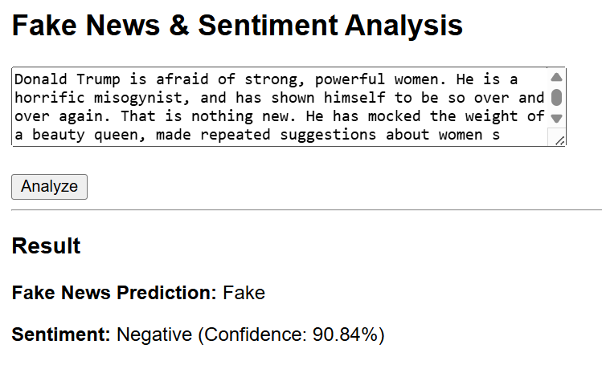

# Fake News Detection & Sentiment Analysis (NLP)

An end-to-end NLP project that classifies news articles as **real or fake** and analyzes their **sentiment**. It starts with classical machine learning baselines, moves through sequence models and pretrained embeddings, and ends with a fine-tuned **BERT** model, plus a small web demo built with FastAPI.



## Dataset
Kaggle *Fake and Real News* dataset (`Fake.csv` and `True.csv`): 44,898 articles, reduced to **39,105** after removing 5,793 duplicates. Subject and date columns were dropped. Split: 80% train / 20% test (7,821 test articles), stratified.

## Pipeline
1. **Preprocessing:** lowercasing, removing punctuation and numbers, tokenization, stopword removal, lemmatization (NLTK). Two copies of the data were kept, one for classical models and one for sequence models.
2. **Classical ML:** Bag-of-Words and TF-IDF features with Logistic Regression, Naïve Bayes, and Linear SVM.
3. **Sequence models:** RNN, LSTM, and GRU (Keras), with 20,000-word vocabulary and padded sequences.
4. **Pretrained embeddings:** GloVe, Word2Vec, and FastText used to initialize a GRU.
5. **Transformer:** `bert-base-uncased` fine-tuned for 2 epochs (PyTorch / Hugging Face).
6. **Sentiment:** `cardiffnlp/twitter-roberta-base-sentiment` (Negative / Neutral / Positive) applied on top.
7. **Demo app:** FastAPI page that returns both the fake-news prediction and the sentiment.

## Results (test set, 7,821 articles)

| Model | Accuracy |
|---|---|
| Naïve Bayes (TF-IDF) | ~95.6% |
| Logistic Regression (TF-IDF) | ~98.7% |
| Linear SVM (TF-IDF) | ~99.5% |
| RNN | 86.1% |
| LSTM | 97.7% |
| GRU | 97.9% |
| GRU + GloVe | 97.3% |
| GRU + Word2Vec | 98.7% |
| GRU + FastText | 96.7% |
| **BERT (fine-tuned)** | **99.9%** (F1 ≈ 0.999) |

Classical accuracies are computed from the confusion matrices in the notebook. Sentiment analysis suggested that fake articles use more emotionally polarized language than real ones.

## Run it
```bash
pip install -r requirements.txt
```
1. Download the dataset and put `Fake.csv` and `True.csv` in a folder named `data` next to the notebook.
2. For the GloVe section, download `glove.6B.50d.txt` and place it next to the notebook.
3. Open `fake_news_detection_nlp.ipynb` and run the cells. The BERT section was trained on a GPU (about 26 minutes per epoch in my run) and saves the model to `saved_fakenews_model/`.

**Web demo:** the trained model is not included in this repo, so run the notebook first. The BERT section needs a GPU (for example Google Colab) and saves the model to `saved_fakenews_model/`. Without that folder the app still starts, but fake news prediction shows "Unavailable" and only sentiment analysis works.

1. Put `sentiment_api.py`, `index.html`, and the `saved_fakenews_model/` folder together in one folder.
2. Open a terminal in that folder and start the app:
```bash
python -m uvicorn sentiment_api:app --port 8000
```
3. Wait until the terminal says `Uvicorn running on http://127.0.0.1:8000` (the first run downloads the sentiment model, so it needs internet).
4. Open `http://127.0.0.1:8000` in your browser. This address only works on your own computer while the terminal stays open.

The model weights (about 440 MB) are not stored in this repo because of GitHub's file size limit. Set the `FAKE_MODEL_PATH` environment variable if you keep them in another location, or point it to a Hugging Face model id if you upload the model there.

## Limitations
- Real articles in this dataset often start with an agency tag such as "(Reuters)", which a model can use as a shortcut, so near-perfect accuracy may not carry over to other kinds of news.
- The sentiment model was trained on Twitter text, so it can be less reliable on long articles.
- Trained on English political news from a single dataset; it may not generalize to other topics or languages.
- Automated fake news detection should support human fact-checking, not replace it.

## Author
Asmaa Mahmoud Saad: Faculty of Computer and Data Science, Alexandria University
